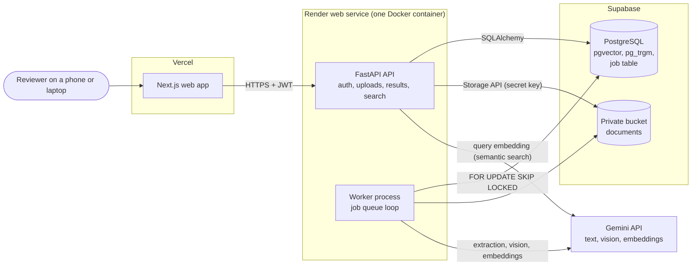
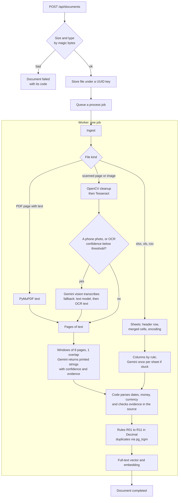

# Architecture

DocIntel is one Python backend (an API process and a worker process in the same container), a PostgreSQL database with pgvector, private file storage, and a Next.js web app. The browser talks to the API only. The API never waits on slow work: uploads are stored and queued, and the worker does the reading, extraction, validation and indexing.

## Components

| Part | Runs where | Does |
|---|---|---|
| Web app | Vercel | Every page renders in the browser and calls the API with the JWT (D49). |
| API | Render, process 1 | Login, uploads, document and job status, results, corrections, search, reconciliation. Never imports the PDF or OCR libraries. |
| Worker | Render, process 2 | Claims jobs from the `jobs` table and runs the pipeline. A heartbeat thread keeps its claim alive. |
| Database | Supabase Postgres | All data, the job queue (D02), full-text and vector search, fuzzy supplier matching. |
| File storage | Supabase Storage | Original files under `<document uuid>/original.<ext>` in a private bucket (D32). |
| Gemini | Google | Reads text, transcribes weak scans, and makes search embeddings. It never calculates (D09). |

Locally, `docker compose up` runs the same API and worker images with a local Postgres and a local file volume instead of Supabase.

## The pipeline

A file that cannot be read fails with its code and is never retried. A model reply that breaks the schema twice fails with `EXTRACTION_FAILED`. Network, quota and storage errors retry with exponential backoff, then fail with the last error (D45). Every step writes a `processing_events` row, which the web app shows as the document's history.

## Data flow for one invoice

1. The model returns each field as the text printed on the page, with a confidence from 0 to 1 and a short evidence snippet (D36).
2. Code turns the text into a `Decimal`, a date or an ISO currency code. Text that does not parse becomes `null` with the flag `unparsed`.
3. Code checks that each value's evidence appears in the source text. An unproven value keeps its value, loses half its confidence and gets `evidence_not_found` (D10).
4. The invoice is stored with its typed values, and per field the confidence, evidence, raw text and flags in `field_meta`.
5. The rules run. Any error-level issue puts the invoice in the review queue (D41).
6. A correction from the web app writes a `corrections` row, re-runs the rules and refreshes search (D48).

## Search

Keyword search uses PostgreSQL full text over invoice numbers, names and line items, indexed in two forms so both exact codes and plain words match (D47). Semantic search embeds the query with the format `task: search result | query: ...` and orders invoices by cosine distance in pgvector (D31). Both share the same filters.

## What production would change

These choices fit a free-tier demo. At real volume:

1. Workers would run on their own machines and scale with the queue, and the queue would move to a dedicated broker once polling load grows (D02, D03). Scaling out needs no code change: `FOR UPDATE SKIP LOCKED` gives each job to exactly one worker (tested), and locally `docker compose up --scale worker=3` runs three. Within one document, page windows already run in parallel up to `LLM_MAX_CONCURRENCY` (D61).
2. Rate limits would move to a shared store, and login to the company's single sign-on with roles (D14, D46).
3. Migrations would run in a release step, not at container start (D25).
4. A document marked as a reference copy would not trigger the duplicate rule (D50).
