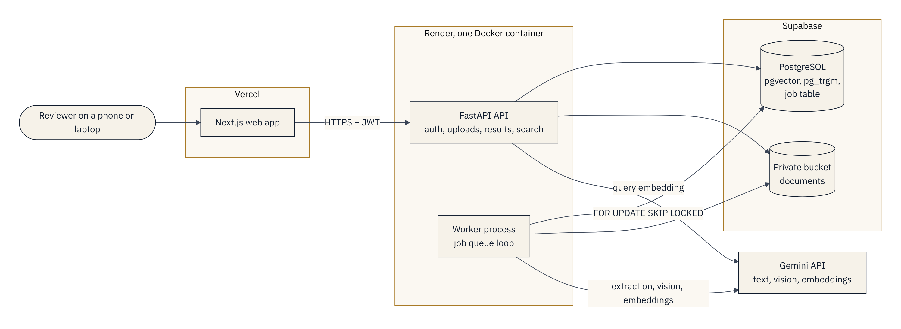
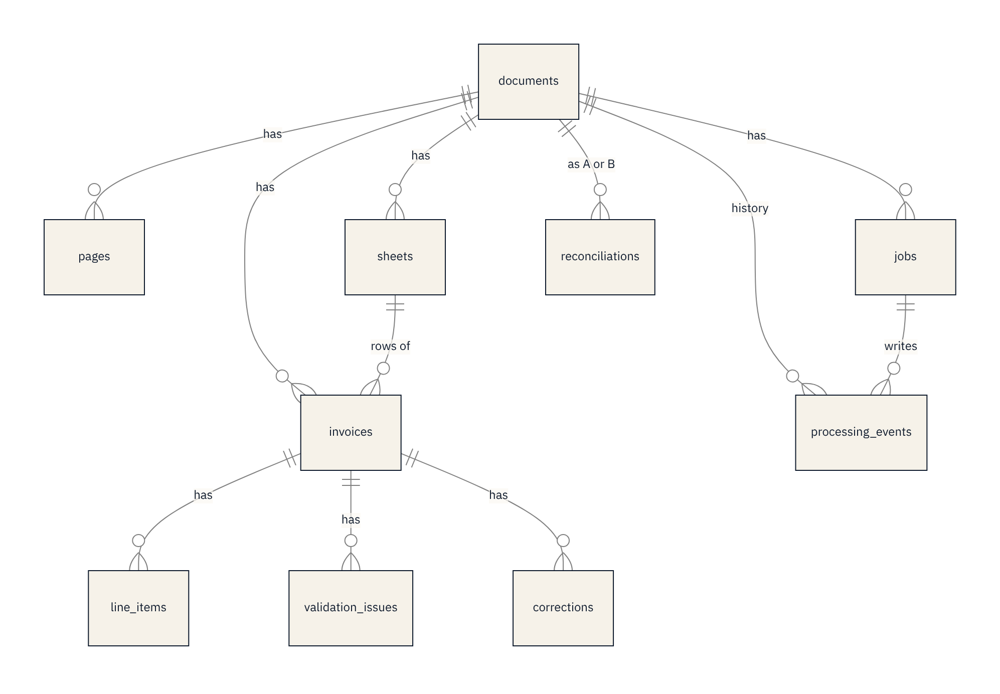
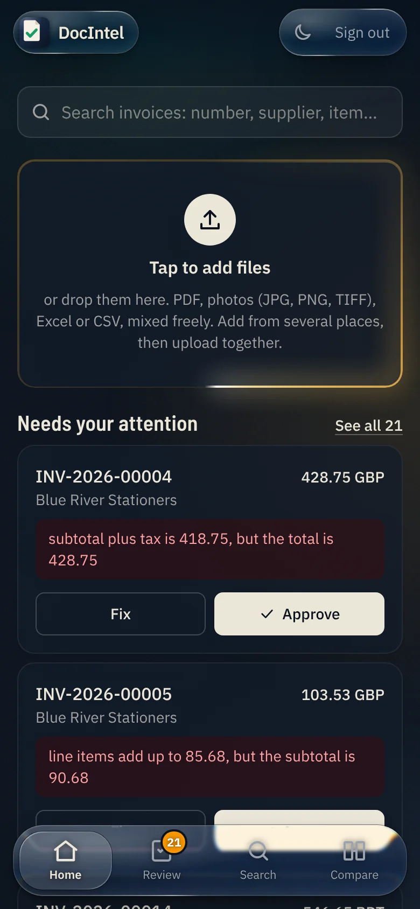
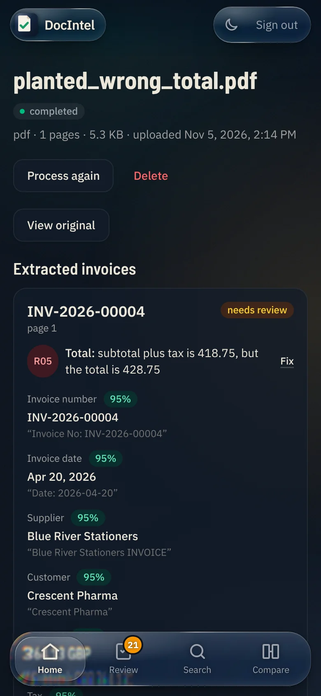
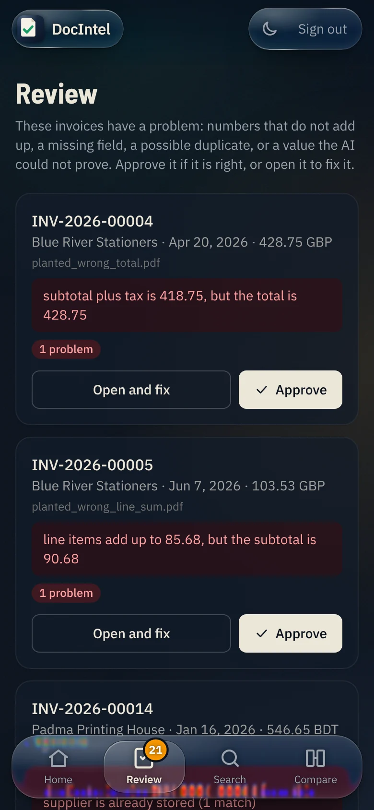
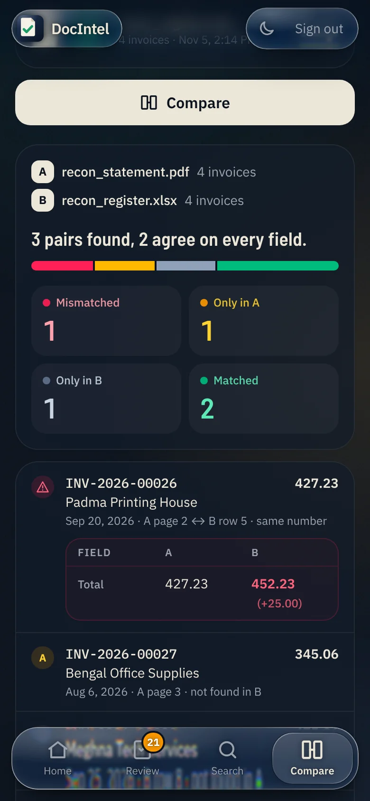

# DocIntel: submission deliverables

AI Engineer assessment, Care Guide. Project: AI-Powered Document Intelligence System. Submitted 7 November 2026.

| | |
|---|---|
| Web app | https://docintel-tan-two.vercel.app (the login is in the submission email) |
| API docs | https://docintel-api-y25b.onrender.com/api/docs |
| Repository | https://github.com/Sowan3k/AI-Powered-Document-Intelligence-System |
| Walkthrough video | https://youtu.be/n9xKvACPR90 |
| This report as a PDF | [Download DocIntel-Deliverables.pdf](https://github.com/Sowan3k/AI-Powered-Document-Intelligence-System/raw/main/docs/DocIntel-Deliverables.pdf) |

DocIntel reads invoices and receipts from PDFs, scans, phone photos, TIFF images, Excel workbooks and CSV files. It extracts the invoice fields with Gemini, checks every number in Python, sends doubtful records to a person, cross-checks one document against another, and makes everything searchable by keyword and by meaning.

The brief lists nine deliverables. This page gives each one in short, with the key results, and links to the full report behind it. The backend runs on Render's free plan and sleeps when idle, so the first request can take up to a minute.

## 1. Git repository with the source code

https://github.com/Sowan3k/AI-Powered-Document-Intelligence-System

| Path | Holds |
|---|---|
| `backend/app/ingest` | File type detection by bytes, PDF, OCR, image and spreadsheet readers |
| `backend/app/extract` | Gemini client, prompts, schemas, page windows, parsing, evidence checks |
| `backend/app/validate` | Rules R01 to R11, duplicates, reconciliation |
| `backend/app/search` | Full-text and vector search |
| `backend/app/worker` | Job queue in PostgreSQL, pipeline, worker process |
| `backend/app/api` | REST API (FastAPI) |
| `frontend/` | Next.js web app |
| `eval/` | Labelled dataset generator, evaluation runner, load test |
| `docs/` | Architecture, schema, security, evaluation, test report, AI usage |

Every design choice, 85 in all, is in [DECISIONS.md](../DECISIONS.md) with the alternatives, the reason and the trade-off.

## 2. README and setup instructions

[README.md](../README.md) describes the system, and its [Installation and setup](../README.md#installation-and-setup) section gives two ways to run it. The quick one needs Git and Docker:

```bash
git clone https://github.com/Sowan3k/AI-Powered-Document-Intelligence-System.git
cd AI-Powered-Document-Intelligence-System
# create .env with GEMINI_API_KEY and the three model names (see the README)
docker compose up --build
```

This starts Postgres with pgvector, the API, the worker and the web app at http://localhost:3000. The other way runs each part by hand. Every setting is listed in the README and in `.env.example`.

## 3. Architecture diagram and database schema



An upload is checked by its bytes, stored in a private bucket under a random key, and queued. The API answers at once. A worker claims the job from a PostgreSQL table and reads the file. It sends the text to Gemini in windows of eight pages, so an invoice that crosses a page edge stays whole. Python then parses the values, runs the rules and indexes the invoice for search. Every step writes a row to the processing history, which the web app shows live.

The database has ten tables:



Money is `NUMERIC(14,2)` in the database and `Decimal` in Python, never a float. Full detail: [ARCHITECTURE.md](ARCHITECTURE.md) (system and pipeline diagrams) and [SCHEMA.md](SCHEMA.md) (every column, index and constraint).

## 4. Working backend API and frontend

Both are live and deploy from `main`: the web app on Vercel, the API and worker on Render, the database and files on Supabase.

| Brief asks for | Endpoint |
|---|---|
| Document uploads | `POST /api/documents` (up to 20 files at once) |
| Processing status | `GET /api/documents/{id}`, `GET /api/activity`, `GET /api/jobs/{id}` |
| Extracted results | `GET /api/documents/{id}/results`, `GET /api/export/invoices.csv` |
| Document search | `GET /api/search` (keyword, meaning, or both, with filters) |
| Manual corrections | `PATCH /api/invoices/{id}`, `GET /api/review-queue` |
| Failed-job reprocessing | `POST /api/jobs/{id}/retry`, `POST /api/documents/{id}/reprocess` |
| Retake a blurred photo | `POST /api/documents/{id}/replace` (the same document, read again from the new file) |
| Cross-verification | `POST /api/reconcile`, `GET /api/reconcile/suggestions` |
| The original file | `GET /api/documents/{id}/file`, `GET /api/documents/{id}/pages/{n}/image` |

OCR and model calls run in a background worker, never in the request. The web app lets a reviewer upload many files at once, watch each move through its steps, inspect every field beside the text it came from, fix and approve flagged invoices, search, and compare two documents.

| Home | Document | Review | Compare |
|---|---|---|---|
|  |  |  |  |

## 5. PDF, image, Excel and CSV processing pipelines

All readers return the same internal structure, so the later stages do not care where the text came from.

| Input | How it is read |
|---|---|
| Digital PDF | PyMuPDF, page by page in batches, so a 1,000-page PDF never sits in memory |
| Scanned PDF, TIFF | OpenCV cleanup (deskew, denoise, threshold), then Tesseract; an upside-down page is detected and turned. Pages with low OCR confidence go to Gemini vision |
| Phone photo (JPG, PNG) | The same OCR step, then Gemini vision for every photo (D82), with fallbacks to the text model and then the OCR text |
| Excel (XLSX, XLS) | openpyxl and xlrd, every sheet, header row detection, merged cells |
| CSV | Python's csv module, with the encoding and delimiter detected |
| Broken files | Each fails alone with a clear code (`CORRUPTED_FILE`, `ENCRYPTED_PDF`, `EMPTY_FILE`, `UNSUPPORTED_TYPE`) and never stops the batch |

Gemini returns each field as printed, with a confidence score and the text it came from, as JSON checked by Pydantic. A missing or unclear value stays empty: the model is told never to guess. Code then parses dates and money, checks that the evidence for the invoice number and total appears in the source, and runs eleven validation rules in `Decimal` arithmetic.

## 6. Automated tests and test results

[TEST_REPORT.md](TEST_REPORT.md) has the full report. From CI run 84 on 5 November 2026:

| Job | Result |
|---|---|
| Backend: ruff, migrations, 428 pytest tests on Postgres 17 with pgvector and Tesseract | Passed, line coverage 96% |
| Frontend: ESLint, TypeScript, production build | Passed |
| Secret scan: gitleaks over the full Git history | Passed |
| Docker: both images build, the compose stack starts, a CSV upload is processed and found by search | Passed |

The tests cover document processing, OCR, spreadsheet parsing, AI extraction (with a fake model), validation, every API endpoint, and failure cases: corrupted, encrypted, empty and mislabelled files, model errors, retries, timeouts and worker crashes. CI runs them on every push.

## 7. Evaluation report with measured metrics

[EVALUATION.md](EVALUATION.md) has the method, every number and the weak spots. Evaluation run 5 used the real Gemini models on 44 synthetic files with 91 labelled invoices:

| Metric | Result |
|---|---|
| Extraction accuracy | 100% of 728 field values (8 fields on 91 invoices) |
| Line items | 224 of 224 (precision and recall 100%) |
| Document success rate | 100% of valid files (35 of 35) |
| Failure rate | 0% |
| Broken files rejected with the right code | 9 of 9 |
| Planted errors caught | 12 of 12, with 1 false flag in 80 clean invoices |
| Files that are not invoices | 4 of 4 gave no invoice |
| Processing time per document | Spreadsheet 1.9 s, digital PDF 23.2 s, scanned PDF 28.3 s (mean) |
| Cost at paid Gemini prices | About $0.0015 per invoice |

Run 8 added nine phone photos at three levels of difficulty: 87.5% of fields right (mild and medium 100%, hard 66.7%). A 1,000-page PDF reads in 2.6 seconds with a 160 MB memory peak. The data is synthetic and cleaner than real invoices, so real accuracy will be lower; the report says where.

## 8. Recorded walkthrough of the working application

Video: https://youtu.be/n9xKvACPR90

It was recorded on a phone, on the live site. The planned script, scene by scene, is in [WALKTHROUGH.md](WALKTHROUGH.md).

## 9. AI prompts and disclosure of AI-assisted development

[AI_USAGE.md](AI_USAGE.md) records which AI tools were used, the main prompts of each working session, what AI wrote, and how each part was checked.

- **Tools.** Claude for planning, and Claude Code for writing code, tests and documentation, phase by phase. Gemini is the runtime model inside the product.
- **Division of work.** I made the architecture and scope decisions and reviewed each phase. Claude Code wrote most of the code under those decisions. A phase closed only when its tests passed in CI.
- **Runtime prompts.** Every prompt the product sends to Gemini is in `backend/app/extract/prompts.py`: extraction, one retry with the validation error, spreadsheet column mapping, vision transcription and search embeddings.
- **Safety rules for the model.** It only reads; all arithmetic runs in Python. Document text sits between fixed markers and is treated as data, and the model gets no tools. One test invoice carries a hidden instruction to change its total, and the system still reads the printed value.

## Speed, scalability, reliability and security

| Quality | What shows it |
|---|---|
| Smooth performance | Uploads return at once and the work runs in the background, with each file's steps shown live. Home holds 60 frames a second with the CPU slowed four times. |
| High speed | A digital page reads in about 3 ms and a spreadsheet in about 2 seconds. The windows of a long PDF go to the model in parallel. Most of the remaining time is the free tier's limit of 12 model calls a minute, which is a setting. |
| Scalability | A 1,000-page PDF streams in batches with flat memory. The job queue lets workers share the load: 1, 2 and 4 workers ran 1.0x, 2.0x and 3.8x as fast. |
| Reliability | Jobs live in the database and survive a restart. Failed calls retry with backoff, a failing model falls back to a second one, and a broken file fails alone. A health check covers the database and file storage. |
| Strong security | Secrets live only in the hosting settings, and gitleaks scans the full Git history on every push. Uploads are checked by their bytes. Files sit in a private bucket. Every route except login and health needs a login token, login and upload are rate-limited, and logs never hold document text. See [SECURITY.md](SECURITY.md). |

## Where the build differs from the suggested stack

The brief allows alternatives with reasons.

| Suggested | Used | Why |
|---|---|---|
| Node.js or NestJS | Python and FastAPI | The OCR, PDF and spreadsheet libraries are Python. One language means one deployment (D01). |
| Redis with BullMQ | A job table in PostgreSQL | Jobs commit with the data they change and survive a restart, with no extra service (D02). |
| A separate vector database | pgvector in PostgreSQL | One query can filter by supplier, date and amount and rank by meaning (D05). |
| pandas | openpyxl and xlrd | pandas would add about 60 MB and more memory on a 512 MB instance, for no gain (D37). |
