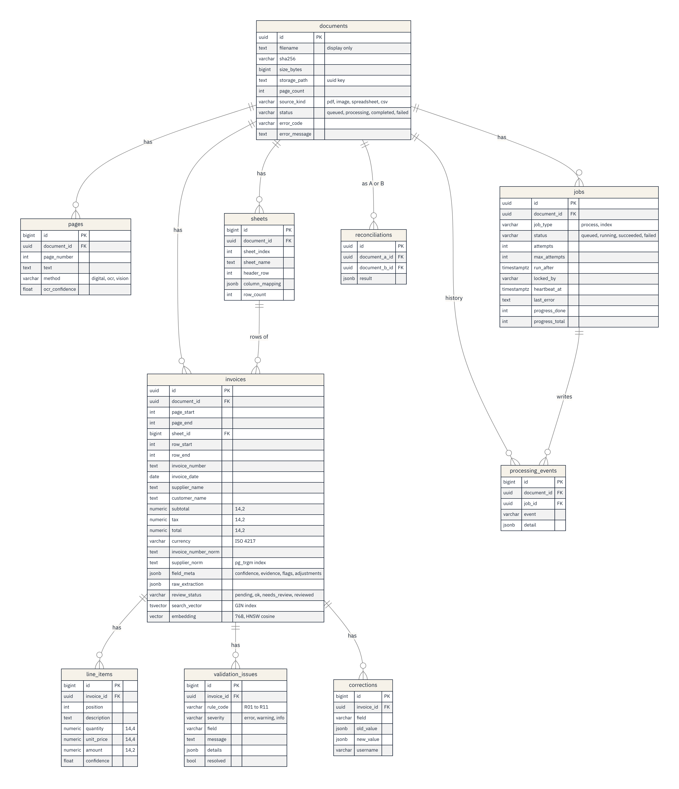

# Database schema

PostgreSQL 17 with the `vector` (pgvector) and `pg_trgm` extensions. One hand-written Alembic migration creates everything (`backend/app/db/migrations/versions/0001_initial_schema.py`), and CI checks that the models and the migration match (`alembic check`).

Rules that apply to every table:

- Rows the API exposes by ID (documents, invoices, jobs, reconciliations) use random UUID keys. Child rows use BIGINT identity keys (D21).
- Money is `NUMERIC(14,2)`; quantity and unit price are `NUMERIC(14,4)` (D22). No column uses floats for money.
- Status columns are VARCHAR with CHECK constraints, mirrored by Python `StrEnum`s (D20).
- Deleting a document deletes everything that belongs to it.

## Indexes that matter

| Index | Serves |
|---|---|
| `ix_jobs_claim (status, run_after)` | The worker's claim query with `FOR UPDATE SKIP LOCKED` |
| `ix_invoices_supplier_number (supplier_norm, invoice_number_norm)` | Duplicate rule R06 |
| `ix_invoices_invoice_date` | Duplicate rule R07 and date filters |
| `ix_invoices_supplier_norm_trgm` (GIN, `gin_trgm_ops`) | Fuzzy supplier matching (D30, D42) |
| `ix_invoices_search_vector` (GIN) | Keyword search |
| `ix_invoices_embedding_hnsw` (HNSW, cosine) | Semantic search (D19) |
| `ix_processing_events_document_time` | A document's history in order |

## Why some data is JSON

`field_meta`, `raw_extraction`, `column_mapping`, issue `details` and the reconciliation `result` change shape with the document or the rule. `field_meta` also holds `currencies_seen` and, when an invoice prints them, `adjustments`: each discount or charge with its label, signed amount, printed text, evidence and flags (D57). `column_mapping` records whether the model judged the sheet to list invoices (D58). JSONB keeps the strict columns strict (values the rules and search use) and the descriptive data flexible (D06).
